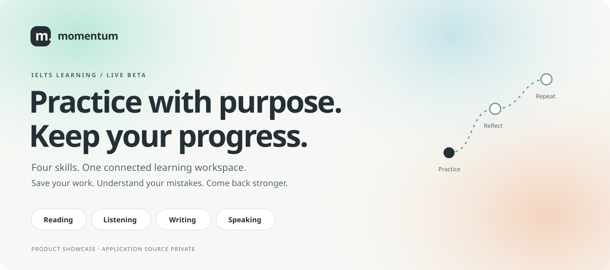

  

  <a href="https://ielts-learning-sage.vercel.app/"><strong>Try the live app ↗</strong></a>
  &nbsp; · &nbsp;
  <a href="docs/product.md">Product walkthrough</a>
  &nbsp; · &nbsp;
  <a href="docs/engineering.md">Engineering & quality</a>

  
  
  
  

# Less noise. More deliberate IELTS practice.

**Momentum** is a four-skill IELTS learning workspace built around a simple loop:
**practice → save → understand → try again**.

Instead of treating every exercise as a score, it keeps drafts, submitted answers,
review notes and assistance conditions distinct. Learners can resume their work,
find evidence for a mistake and decide what to practise next.

> **Giới thiệu ngắn:** Nền tảng tự luyện IELTS đủ bốn kỹ năng, có tài khoản,
> lưu bài và đồng bộ. Tập trung vào trải nghiệm học thật, hiểu lỗi sai và tiếp tục
> đúng bài đang làm — không tạo band hoặc tiến độ giả.

## Explore the four study desks

| Skill | What learners can do |
| :--- | :--- |
| **Reading** | Browse complete papers, practise individual Parts, use a split reading desk, save highlights and compare submitted answers with evidence. |
| **Listening** | Filter short practice units, play actual audio, save answers and revisit timestamped explanations after submission. |
| **Writing** | Choose Task 1/2 prompts, plan and draft, keep the submitted original and save a separate self-review. |
| **Speaking** | Prepare ideas, record, listen back and save private audio when signed in and storage is configured. |

### A learning journey that stays connected

- **Resume, not restart:** continue an existing draft from the dashboard or history.
- **One account, saved work:** Google sign-in and server-backed account synchronization.
- **Originals stay original:** a submitted response is separate from later reflection.
- **Review with context:** mistakes, vocabulary and prior attempts retain their source.
- **A calmer interface:** Aurora light/dark styling, responsive layouts and keyboard paths.
- **Honest progress:** practice evidence is not an examiner grade or an invented IELTS band.

## The product in numbers

The deployed content inventory recorded on **9 November 2026** includes:

| Area | Inventory |
| :--- | ---: |
| Reading | 26 complete papers / 78 Parts |
| Listening | 29 short units / 159 questions |
| Writing | 40 original Task 1/2 prompts |
| Speaking | 24 Parts 1–3 prompts |

Reading includes original material and a licensed collection made available under
the project owner's confirmed permission. **No third-party papers, answer keys,
audio files or extracted corpus are distributed in this repository.**
Listening units are short technique exercises with synthesized audio, not full
official mock exams.

## Built to be useful, not just look finished

| Engineering area | Approach |
| :--- | :--- |
| Application | Next.js, React and TypeScript |
| Account layer | Supabase Auth and PostgreSQL |
| Local learning runtime | SQLite with explicit account boundaries |
| Quality | Vitest, Playwright, axe and content-integrity checks |
| Delivery | Vercel-hosted application; source maintained separately |

**Latest local acceptance, 9 November 2026:** 974 unit/component/integration tests
passed. Managed local E2E ended with 103 passing cases and one cloud-only skip
across 37 specifications; the separate cloud/ licensed lane passed 34 cases.
These are dated engineering results, **not a live CI badge or a claim that every
local improvement is already deployed**.

Real-account checks confirmed a labeled QA Writing draft persisted after reload
and in a second tab, an earlier submitted Writing original remained unchanged,
and an existing Speaking recording played back successfully. Separate-device
sync and new physical microphone capture were not re-certified in that session.

## Try it

1. Open **[Momentum IELTS](https://ielts-learning-sage.vercel.app/)**.
2. Sign in with Google to access your saved workspace.
3. Pick a skill and begin a practice activity.
4. Save a draft, return through History and review after submitting.

Writing and Speaking currently support **self-review**, not automated examiner
grading. Please do not treat this beta as an official IELTS product or a band
guarantee. See [product scope and limitations](docs/product.md).

## About this repository

This is the **public product showcase** for Momentum. It contains only the
presentation, product notes and original marketing artwork.

- Application source and implementation history are kept in a **separate private repository**.
- No `.env`, API credentials, learner records, recordings or private corpus are included.
- The hosted application runs independently of this showcase repository.
- Publishing this presentation does **not** open-source the application or grant rights to third-party learning materials.

Built and maintained by **[Sonness](https://github.com/Sonness1304)**.
