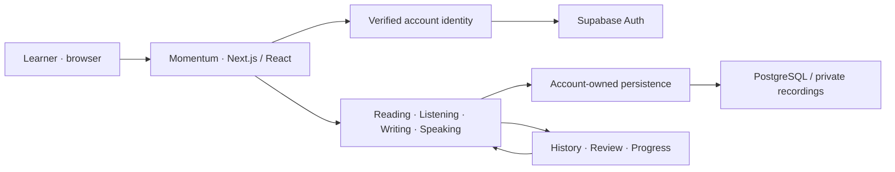

# Engineering notes

This page describes the system at a high level. It does not contain application
source, database credentials or deployable infrastructure configuration.

## System overview

The original local application also has a SQLite runtime. Cloud and local
verification are reported separately; a test adapter is not a production login.

## Invariants worth protecting

1. A client-supplied account identifier must not authorize learner data access.
2. A draft is not a submission, and a submission is not an examiner grade.
3. Submitted originals remain separate from later reflection.
4. Repeating an operation after a lost acknowledgment must not duplicate its effect.
5. Assistance, source exposure and content version/provenance stay explicit.
6. Empty evidence is not a fabricated zero score, IELTS band or mastery claim.
7. Presentation changes must not silently alter persistence or ownership.

## Verification layers

| Layer | What it checks |
| :--- | :--- |
| Unit/component/integration | Domain rules, forms, persistence, recovery and account boundaries |
| Browser regression | The connected practice, save, submit, history and review journeys |
| Content validation | Published content identity, provenance and media hashes |
| Accessibility checks | Automated contrast/structure checks, keyboard paths and responsive states |
| Real-account acceptance | Bounded observations on the hosted service with explicitly labeled QA work |

### Dated acceptance snapshot — 9 November 2026

- 974/974 unit/component/integration tests passed.
- Local E2E: 103 passed, one intentional cloud-only skip, 37 specifications.
- Separate cloud + licensed-content E2E: 34 passed, nine specifications.
- Typecheck, lint, content validation and build passed.
- Dependency audit reported zero known vulnerabilities at that time.

The local E2E result consolidates the final unique outcome for each specification
after fixing reproduced failures; it is not represented as a single uninterrupted
run. The cloud lane uses fixtures, not real production learner submissions.
These figures describe the tested revision and date, not future guarantees.

## Public/private separation

This repository is an allowlisted presentation-only artifact. Application code
and Git history live in a different private repository. Credentials, encryption
keys, learner databases and third-party corpus are not source-control backups,
even in a private repository.
